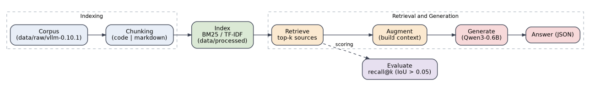

*This project has been created as part of the 42 curriculum by dzhambal.*

# RAG against the machine

## Description

A Retrieval-Augmented Generation (RAG) system that answers questions about a
codebase. RAG ingests the provided vLLM repository into a searchable index,
retrieve the most relevant snippets for a question, generate an answer from
them with Qwen/Qwen3-0.6B, and measure retrieval quality with recall@k. RAG
system is judged on whether it retrieves the right source locations and
produces answers grounded in them.



A language model only knows what it saw during training, so it cannot answer
questions about a specific codebase. This project gives a small local model
(`Qwen/Qwen3-0.6B`) access to that codebase at answer time:

1. **Indexing**: every Python, Markdown and text file of the repository is
   split into chunks and stored in a BM25 index.
2. **Retrieving**: a question is matched against the index and the most
   relevant source locations (file path and character range) are returned.
3. **Augmenting**: the retrieved snippets are read from disk and placed in
   the prompt of the model.
4. **Generating**: the model writes an answer grounded in those snippets.

Retrieval quality is measured with recall@k against reference datasets.
Everything runs on a CPU (no GPU needed). Datasets and outputs follow the
pydantic models required by the subject.

## Instructions

### Requirements

- Python 3.10 or later and [uv](https://docs.astral.sh/uv/).
- The vLLM 0.10.1 repository in `data/raw/` (so files are under
  `data/raw/vllm-0.10.1/`) and the question datasets in
  `data/datasets/AnsweredQuestions/` and `data/datasets/UnansweredQuestions/`.
- Several gigabytes of free disk space: the CPU build of PyTorch, the
  `transformers` stack and the model weights, which are downloaded from
  Hugging Face the first time an answer is generated.

### Installation

```bash
make install        # runs: uv sync
```

The project is configured (in `pyproject.toml`) to install the CPU-only build
of PyTorch. The development tools (flake8, mypy, pytest) are declared in
`pyproject.toml` as well.

### Makefile rules

| Rule | What it does |
|---|---|
| `make install` | install the dependencies with `uv sync` |
| `make run` | build the index, then search the public docs dataset |
| `make debug` | run the `index` command under Python's debugger (`pdb`) |
| `make clean` | remove `__pycache__`, `.mypy_cache` and `.pytest_cache` |
| `make fclean` | `clean`, plus delete `data/processed/*` and `data/output/*` |
| `make lint` | `flake8 .` and `mypy` with the flags required by the subject |
| `make lint-strict` | `flake8 .` and `mypy --strict` |

`make run` accepts overrides, e.g.
`make run K=5 MAX_CHUNK_SIZE=1500 DATASET=... SAVE_DIR=...`.

Unit tests (not part of the evaluation): `uv run python -m pytest tests`.

### Command-line interface

Every command is run as `uv run python -m src <command> [options]`
(built with Python Fire).

| Command | Main options | Purpose |
|---|---|---|
| `index` | `--max_chunk_size` (default 2000), `--raw_dir`, `--processed_dir` | chunk `data/raw/` and save the index under `data/processed/` |
| `search <query>` | `--k`, `--index_path` | print the top-k sources of one query |
| `search_dataset` | `--dataset_path`, `--k`, `--save_directory`, `--index_path` | search a whole dataset, write a `StudentSearchResults` JSON |
| `answer <query>` | `--k`, `--index_path`, `--model_name` | retrieve and answer one question |
| `answer_dataset` | `--student_search_results_path`, `--save_directory`, `--model_name` | answer a whole dataset, write a `StudentSearchResultsAndAnswer` JSON |
| `evaluate` | `--student_search_results_path`, `--dataset_path` | print recall@1/3/5/10 against a ground-truth dataset |

All input and output paths are CLI arguments. Invalid input (empty query,
`k=0`, non-integer `k`, missing files, malformed JSON) never produces a
traceback: harmless cases print a warning and exit with status 0, real errors
print `Error: ...` on stderr and exit with status 1.

### Example usage

```bash
# 1. Build the index (about 6 seconds for the whole corpus)
uv run python -m src index --max_chunk_size 2000

# 2. One query
uv run python -m src search "How to configure the OpenAI server?" --k 5

# 3. A whole dataset, then recall
uv run python -m src search_dataset \
    --dataset_path data/datasets/UnansweredQuestions/dataset_docs_public.json \
    --k 10 \
    --save_directory data/output/search_results/UnansweredQuestions

uv run python -m src evaluate \
    --student_search_results_path data/output/search_results/UnansweredQuestions/dataset_docs_public.json \
    --dataset_path data/datasets/AnsweredQuestions/dataset_docs_public.json

# 4. Answers for the saved search results
uv run python -m src answer_dataset \
    --student_search_results_path data/output/search_results/UnansweredQuestions/dataset_docs_public.json \
    --save_directory data/output/search_results_and_answer/UnansweredQuestions
```

Typical output of the first and the third step:

```
Ingestion complete! 1969 files, 16400 chunks in 7.0s. Indices saved under data/processed/
Evaluation Results
========================================
Recall@1: 0.680  Recall@3: 0.770  Recall@5: 0.850  Recall@10: 0.900
```

The official score is computed by the provided `moulinette` executable:

```bash
./moulinette/moulinette-ubuntu evaluate_student_search_results \
    data/output/search_results/UnansweredQuestions/dataset_docs_public.json \
    data/datasets/AnsweredQuestions/dataset_docs_public.json \
    --k 10 --max_context_length 2000
```

## System architecture

```
  INDEXING                                         QUESTION ANSWERING

  data/raw/                                        question
     |                                                |
     v                                                v
  CodebaseIngestor   (find and read files)         CodebaseRetriever   (load index, top-k)
     |                                                |
     v                                                v  list of MinimalSource
  Chunkers           (Python / Markdown)           (file path + character range)
     |                                                |
     v                                                v
  BM25 index         (tokenize, build)             CodebaseAnswerGenerator
     |                                              (read snippets, prompt, Qwen3-0.6B)
     v                                                |
  data/processed/bm25_index.pkl  ---- loaded by ----> |
                                                      v
                                                  answer (JSON)
```

```
src/
├── __main__.py            CLI (Python Fire)
├── models/models.py       pydantic models of the subject
├── indexing/
│   ├── ingestion.py       file discovery, exact text reading
│   ├── chunking.py        CodeChunk, MarkdownChunk, ChunkFactory
│   ├── bm25.py            tokenizer and BM25 index
│   └── indexer.py         orchestrates chunking, indexing and saving
├── retrieval/retriever.py loads the index, single and batch search
├── generation/generator.py prompt building and answer generation
└── evaluation/evaluator.py recall@k against a ground-truth dataset
```

- **Ingestion** lists the `.py`, `.md`, `.markdown`, `.txt` and `.rst` files of
  `data/raw/` in a stable order (skipping `.git`, `__pycache__`,
  `node_modules`, `.venv`) and reads them as UTF-8 without newline
  translation. Files that cannot be decoded are skipped with a message.
- **Chunking** turns each file into `Chunk` objects (pydantic): the text and a
  `MinimalSource` (path, first and last character index).
- **Indexing** tokenizes the chunks, builds the BM25 index and pickles it to
  `data/processed/bm25_index.pkl`.
- **Retrieval** loads the pickle once and returns ranked `MinimalSource`
  objects, for one query or for a whole dataset (with a progress bar).
- **Generation** reads the text of the retrieved sources from the files,
  builds a prompt and generates the answer with Qwen3-0.6B.
- **Evaluation** reimplements recall@k for local experiments.

## Chunking strategy

Two strategies are implemented, selected by file extension (`ChunkFactory`).
Both share the same mechanism, based on **spans**: a span is a pair
`(start, end)` of offsets in the original text, and a chunk's content is
always `text[start:end]`. Offsets can therefore never drift away from the
real file content.

1. The text is cut into small *units* (see below).
2. A unit longer than `max_chunk_size` is split again, preferably after a
   newline (hard cut if there is none), so no chunk ever exceeds the limit.
3. Neighbouring units are merged greedily while the result fits in
   `max_chunk_size`.
4. Chunks that contain only whitespace are dropped.

**Python files (`CodeChunk`).** The file is parsed with `ast`. A new unit
starts at every top-level statement and at every class member (methods,
nested classes), including decorators and the comments right above a
definition. A function or method that fits in the limit therefore stays in
one piece. When a new `def`/`class` starts and the current chunk is already
at least a third full, a new chunk is started instead of gluing unrelated
definitions together. If the file cannot be parsed, every line becomes a unit.

**Markdown and text (`MarkdownChunk`).** Units are paragraphs (separated by
blank lines). A heading line is glued to the paragraph that follows it, and a
new chunk is preferably started at a heading (when the current chunk is at
least a third full). This keeps a title together with its content. Any other
extension falls back to this strategy.

`--max_chunk_size` is configurable (default 2000, maximum 2000: the grader
rejects longer sources). Files are read with `newline=""`, so CRLF files keep
the offsets expected by the grader. Paths are stored in POSIX form relative to
the project root, exactly as in the corpus (`data/raw/vllm-0.10.1/...`).

## Retrieval method

Lexical retrieval with **BM25 Okapi** (`rank-bm25`, `k1 = 1.5`, `b = 0.75`)
over all chunks. What is indexed decides what can be matched, so the
tokenizer was designed for code:

- **Identifiers are indexed twice**: whole (`get_num_unfinished_requests`) and
  split into words (`get`, `num`, `unfinished`, `requests`), also at camelCase
  boundaries (`LoRARequest` gives `lorarequest`, `lo`, `ra`, `request`). A
  question quoting an identifier verbatim and a question paraphrasing the idea
  with plain words both match.
- **The file path is indexed with each chunk**, so a question about a feature
  finds the right file even if that chunk does not repeat the feature name.
- One-character tokens are dropped. Common English question words (`how`,
  `what`, `the`, ...) are removed from the query only, not from the index.

**Ranking:** the score of every chunk is computed, the top k are selected with
`numpy.argpartition` and ordered by score (ties broken by position). Only
chunks with a positive score are returned, so an empty or nonsensical query
returns no sources instead of arbitrary ones.

## Performance analysis

Measured on the public datasets (100 docs questions, 99 code questions) with
the project's own `evaluate` command, which applies the rule of the subject (a
source is found when a top-k result is in the same file and overlaps its
range with an IoU of at least 0.05). The official `moulinette` score may
differ slightly.

**Required:** recall@5 of at least 80 % on docs and 50 % on code, indexing in
at most 5 minutes, 200 questions searched in at most 90 seconds.

Effect of `--max_chunk_size` (BM25 `k1 = 1.5`, `b = 0.75`):

| max_chunk_size | Chunks | Index time | Docs R@1 | R@3 | R@5 | R@10 | Code R@1 | R@3 | R@5 | R@10 |
|---:|---:|---:|---:|---:|---:|---:|---:|---:|---:|---:|
| 500 | 51 490 | 7.7 s | 0.670 | 0.800 | 0.840 | 0.850 | 0.535 | 0.697 | 0.788 | 0.889 |
| 1000 | 28 409 | 8.2 s | 0.630 | 0.770 | 0.810 | 0.890 | 0.515 | 0.717 | 0.778 | 0.869 |
| 1500 | 20 455 | 6.9 s | 0.680 | 0.820 | 0.850 | 0.890 | 0.495 | 0.697 | 0.788 | 0.869 |
| **2000 (default)** | 16 400 | 5.8 s | 0.680 | 0.770 | **0.850** | 0.900 | 0.485 | 0.727 | **0.768** | 0.859 |

Search time for a whole dataset (the search loop only, as shown by the
progress bar):

| max_chunk_size | Docs (100 questions) | Code (99 questions) |
|---:|---:|---:|
| 500 | 16 s | 21 s |
| 1000 | 9 s | 13 s |
| 1500 | 6 s | 8 s |
| 2000 | 5 s | 6 s |

Observations:

- **Every size meets the thresholds** with a wide margin on code (0.77–0.79
  against 0.50) and a smaller one on docs (0.81–0.85 against 0.80).
- **Indexing** takes 6 to 8 seconds for the whole corpus (1969 files), far
  below the 5-minute limit. **Search** of 200 questions would take roughly
  10 to 45 seconds depending on the chunk size, below the 90-second limit.
- **Smaller chunks are not clearly better.** They help a little on code
  recall@1 and recall@5 (0.535 and 0.788 at size 500), but docs recall@10
  drops (0.850 against 0.900), there are three times more chunks and search is
  three to four times slower. The differences are a few questions out of 100,
  so they are partly noise.
- **The default of 2000 characters** gives the best docs recall@5 (tied with
  1500) and recall@10, the fewest chunks and the fastest search, so it is kept.
- **Answer generation** runs on the CPU. It uses a short prompt (3 snippets)
  and at most 256 new tokens to keep the time per question reasonable.

## Design decisions

- **BM25 instead of TF-IDF.** BM25 normalizes by chunk length and saturates
  term frequency, which suits chunks of very different sizes. BM25 alone is
  enough to pass the required thresholds.
- **Span-based chunking.** Computing the content from `(start, end)` made it
  impossible to report indices that do not match the text, and made the
  2000-character limit easy to guarantee and to test.
- **`ast` for Python, paragraphs and headings for Markdown.** Chunks follow the
  structure of the content (a function, a section), which is what questions
  ask about, instead of cutting at arbitrary positions.
- **Custom tokenizer.** Splitting identifiers and keeping them whole handles
  both kinds of questions described in the subject. Indexing the path adds
  context cheaply.
- **Index saved with `pickle`.** The BM25 object and the chunks are stored in
  one file, so loading is a single call. The index is rebuilt in seconds, so
  there is no versioning.
- **pydantic models** are used for everything exchanged between stages (chunks,
  datasets, search results, answers) and validate the JSON read from disk.
- **Heavy imports on demand.** `torch` and `transformers` are imported only by
  `answer` and `answer_dataset`, so `search` starts quickly.
- **Prompt strategy.** Qwen3 is used through its chat template with thinking
  disabled. A system prompt tells it to answer only from the numbered
  snippets, to say so when they do not contain the answer, and not to invent
  names. Each snippet is preceded by its file path. Only the first three
  retrieved sources are used, each cut to 2000 characters, to keep the prompt
  short on a CPU.
- **Error handling.** Reading, parsing and generation errors are caught per
  file or per question, so one bad file or question does not stop a whole run.

## Challenges faced

- **Exact offsets.** The first chunkers built the text and counted indices
  separately, which lost text for very long paragraphs and shifted all later
  indices. The span-based approach, plus tests that check
  `text[first:last] == content` for every chunk, solved it.
- **Windows line endings.** Reading files in text mode converts `\r\n` to `\n`
  and shifts offsets. Files are now read with `newline=""` everywhere,
  including when snippets are read back for generation.
- **The 2000-character hard limit.** A single oversized chunk invalidates the
  whole output, so any unit that is too long (a very long line, a huge
  paragraph, a big class) is split, and the limit is validated once before
  indexing.
- **Identifier versus paraphrase.** A plain "split on punctuation" tokenizer
  loses the full identifier and does not split camelCase. The two-way
  tokenization described above fixes both.
- **Degenerate queries.** With all-zero scores a naive ranking returns the
  first chunks of the corpus. Only positive scores are returned now, and the
  CLI handles empty queries, `k=0`, non-numeric `k` and malformed files.
- **CPU generation.** A 0.6B model on a CPU is slow, so the prompt is kept
  short and the output length is capped.
- **Tooling.** `flake8 .` scans `.venv` and `data/` (the whole vLLM repository)
  unless excluded, so `.flake8` lists the folders to skip. The type stubs of
  `transformers` reject valid calls on loaded models, which required typing the
  model attribute loosely in `generator.py`.

## Resources

**Documentation and references**

- What is RAG (Retrieval-Augmented Generation)?: <https://aws.amazon.com/ru/what-is/retrieval-augmented-generation/>
- RAG: teaching artificial intelligence to work with new data: <https://yandex.cloud/ru/blog/posts/2025/05/retrieval-augmented-generation-basics?utm_referrer=https%3A%2F%2Fwww.google.com%2F>.
- Embeddings in simple terms: what they are and how a neural network turns text into vectors: <https://cloud.ru/blog/embeddingi>
- `rank-bm25` library: <https://github.com/dorianbrown/rank_bm25>
- Qwen3 model card: <https://huggingface.co/Qwen/Qwen3-0.6B> and the Qwen3
  Technical Report: <https://arxiv.org/abs/2505.09388>
- Hugging Face `transformers` documentation (chat templates, generation):
  <https://huggingface.co/docs/transformers>
- Python `ast` module: <https://docs.python.org/3/library/ast.html>
- pydantic: <https://docs.pydantic.dev> · Python Fire:
  <https://github.com/google/python-fire> · tqdm:
  <https://tqdm.github.io> · uv: <https://docs.astral.sh/uv/>
- vLLM: <https://github.com/vllm-project/vllm>

**Use of AI**

AI was actively utilized as a collaborative peer/teacher review system during learning theory, explanation problems and creating README. AI was used during the project for:

- finding bugs in the first version of the chunkers (lost text, shifted
  indices, over-long chunks) and proposing the span-based design, then helping
  to rewrite `chunking.py`;
- suggesting the identifier-aware tokenizer, the path tokens and the
  retrieval edge cases, and helping to rewrite `bm25.py`;
- helping to rewrite `ingestion.py`, `indexer.py`, `retriever.py`,
  `generator.py` (prompt strategy) and the CLI, and to write the `evaluate`
  command.
